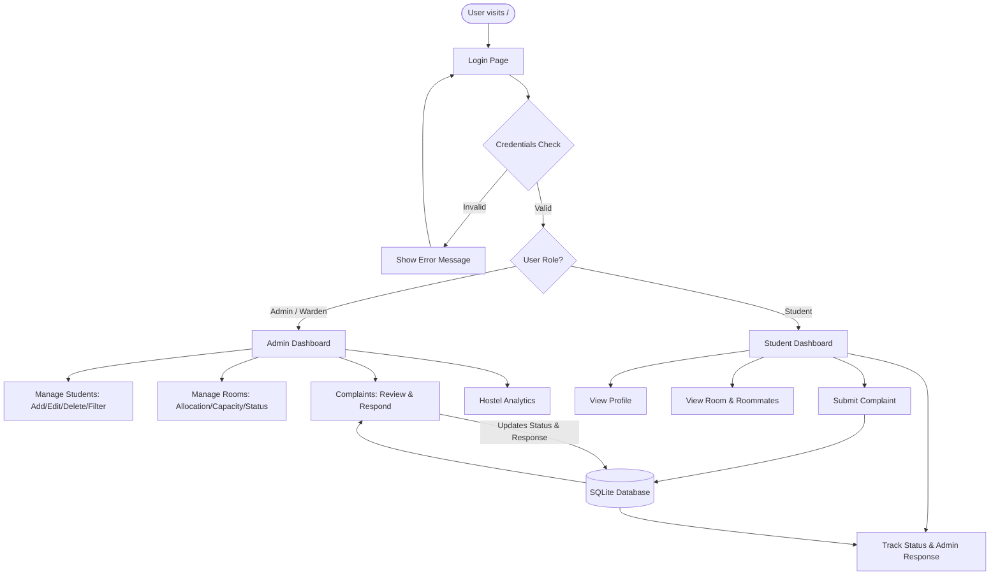

# HOSTEL MANAGEMENT SYSTEM

A complete, responsive web application built with **Python Django**, **SQLite**, and **Bootstrap 5**, tailored for MCA / Computer Science academic mini project demonstrations and reviews.

---

## 1. Features Overview

### Role 1: Admin / Warden
* **Secure Authentication:** Dedicated dashboard access with staff-level privileges.
* **Dashboard Analytics:** Real-time counters for Total Students, Total Rooms, Available Rooms, Occupied Rooms, Pending Complaints, and Resolved Complaints.
* **Student Management:**
  * Add, view, edit, and delete students.
  * Search by Student ID, name, email, or phone.
  * Filter students by Department, Academic Year, Gender, and Room Allocation status.
* **Room Management:**
  * Add, view, edit, and delete rooms.
  * Real-time capacity and occupancy tracking (progress bar visualization).
  * Room availability status (Available, Full, Under Maintenance).
  * Prevent over-allocation (cannot assign student to full rooms).
* **Complaint Resolution System:**
  * View complaints categorized by Electrical, Plumbing, Cleaning, Food, Water, Internet, Room, etc.
  * Filter by Status (Pending, In Progress, Resolved, Rejected).
  * Update complaint status and post official admin responses/remarks visible to students.
* **Hostel Statistics:** Visual analytical breakdowns by block, department, year, and complaint categories.

### Role 2: Student
* **Student Login:** Login using unique Student ID (e.g., `STU001`) and password.
* **Student Dashboard:** Personal accommodation summary, active complaints, and quick actions.
* **Profile Management:** View personal contact, academic details, and assigned room.
* **Room Details:** View allocated room specifications, block, floor, capacity, and names/contacts of roommates.
* **Complaint Lodging:** Submit maintenance issues with category, subject, and detailed description.
* **Live Complaint Tracking:** View status updates and warden responses in real time.
* **Strict Privacy Isolation:** Students can strictly only view and manage their own complaints and details.

---

## 2. Installation & Setup Instructions

### Prerequisites
* Python 3.10+ installed on your system.

### Step 1: Open Terminal in Project Directory
```powershell
cd c:\Users\Admin\Documents\miniproject
```

### Step 2: Apply Database Migrations
Create database tables in SQLite:
```powershell
python manage.py makemigrations
python manage.py migrate
```

### Step 3: Populate Sample Data (Automated)
Run the custom seed command to create rooms, students, sample complaints, and administrator accounts:
```powershell
python manage.py seed_data
```

### Step 4: (Optional) Create Custom Superuser Manually
If you want to create your own custom administrator account:
```powershell
python manage.py createsuperuser
```

### Step 5: Start Development Server
```powershell
python manage.py runserver
```
Open your browser and visit: **http://127.0.0.1:8000/**

---

## 3. Demo Login Credentials

| Role | Username / Student ID | Password | Notes |
| :--- | :--- | :--- | :--- |
| **Administrator** | `admin` | `admin123` | Full superuser access |
| **Hostel Warden** | `warden` | `warden123` | Staff administrative access |
| **Student 1** | `STU001` | `student123` | Rahul Sharma (MCA - Room A-102) |
| **Student 2** | `STU002` | `student123` | Amit Verma (MCA - Room A-102) |
| **Student 3** | `STU003` | `student123` | Priya Patel (CSE - Room B-102) |
| **Student 4** | `STU004` | `student123` | Sneha Nair (IT - Room B-102) |
| **Student 5** | `STU008` | `student123` | Karthik Reddy (Unassigned student) |

---

## 4. Project Folder Structure

```
miniproject/
│
├── manage.py                          # Django CLI utility
├── db.sqlite3                         # SQLite database file
├── README.md                          # Comprehensive documentation
│
├── hostel_system/                     # Project configuration directory
│   ├── __init__.py
│   ├── settings.py                    # App configuration, database, static files, auth settings
│   ├── urls.py                        # Root URL dispatcher
│   ├── asgi.py                        # ASGI entrypoint
│   └── wsgi.py                        # WSGI entrypoint
│
├── hostel/                            # Main Hostel Management application
│   ├── __init__.py
│   ├── admin.py                       # Django Admin configuration for Room, Student, Complaint
│   ├── apps.py                        # Application metadata
│   ├── models.py                      # Database models (Room, Student, Complaint)
│   ├── forms.py                       # Form validation (Login, Student, Room, Complaint)
│   ├── views.py                       # Controller logic for Admin & Student portals
│   ├── urls.py                        # App URL routes
│   ├── decorators.py                  # Access control decorators (@admin_required, @student_required)
│   ├── tests.py                       # Automated unit & integration tests
│   │
│   └── management/
│       └── commands/
│           └── seed_data.py           # Sample data population command
│
├── static/                            # Static assets
│   └── css/
│       └── custom.css                 # Custom Bootstrap 5 styles, badges, cards
│
└── templates/                         # Django HTML Templates
    ├── base.html                      # Main layout (Navbar, Sidebar, Alerts, Footer)
    │
    ├── auth/
    │   └── login.html                 # Unified login page with demo credentials box
    │
    ├── admin/
    │   ├── dashboard.html             # Warden dashboard with metric cards & recent activities
    │   ├── student_list.html          # Student table with search, filter, and action buttons
    │   ├── student_form.html          # Add / Edit student form
    │   ├── student_detail.html        # Student profile, room details & complaints history
    │   ├── room_list.html             # Room grid/table with occupancy progress bars
    │   ├── room_form.html             # Add / Edit room form
    │   ├── room_detail.html           # Room occupant management & bed allocation
    │   ├── complaint_list.html        # Complaints review table with category/status filters
    │   ├── complaint_detail.html      # Warden complaint response form
    │   ├── stats.html                 # Analytical hostel statistics & charts
    │   └── confirm_delete.html        # Reusable delete confirmation modal
    │
    └── student/
        ├── dashboard.html             # Student dashboard with accommodation summary
        ├── profile.html               # Student personal & academic profile
        ├── my_room.html               # Room details & roommate list
        ├── submit_complaint.html      # Complaint submission form
        ├── my_complaints.html         # Status tracking for lodged complaints
        └── complaint_detail.html      # Single complaint view with warden's reply
```

---

## 5. System Workflow Explanation



1. **Authentication Flow:**
   * When any user visits the site, they are presented with a unified login screen.
   * Standard Django authentication verifies credentials against `auth_user`.
   * If `user.is_staff = True`, the user is routed to `/admin-dashboard/`.
   * If `user` is linked to a `Student` record, they are routed to `/student-dashboard/`.

2. **Room Allocation & Auto-Capacity Flow:**
   * Each `Room` has a defined capacity (number of beds).
   * When a student is assigned to a room, the room's `occupied_count` is automatically recalculated via `update_occupancy()`.
   * If `occupied_count >= capacity`, the room's status automatically switches to **Full**.
   * When a student is unassigned or deleted, the bed space is automatically freed up and status returns to **Available**.
   * Validation prevents assigning students to full rooms or rooms under maintenance.

3. **Complaint Resolution Flow:**
   * A student submits a complaint with a category (e.g. Electrical, Plumbing), subject, and description.
   * An ID (`CMP-0001`) is automatically assigned.
   * Initial status is set to **Pending**.
   * The warden sees the complaint immediately on the admin dashboard and complaints list.
   * The warden reviews the issue, updates the status (**In Progress**, **Resolved**, or **Rejected**), and enters a response.
   * The student's portal reflects this response instantly.

---

## 6. Important Files & Their Roles

| File | Purpose |
| :--- | :--- |
| `hostel/models.py` | Defines `Room`, `Student`, and `Complaint` database tables with auto-updating capacity and complaint ID generation logic. |
| `hostel/forms.py` | Contains form classes with clean validation rules (10-digit phone number, room capacity check, non-empty text). |
| `hostel/views.py` | Contains all backend request handlers for authentication, student management, room allocation, and complaint tracking. |
| `hostel/decorators.py` | Contains `@admin_required` and `@student_required` access controls to protect views from unauthorized access. |
| `hostel/urls.py` | Maps clean URL routes to corresponding views. |
| `hostel/admin.py` | Configures the built-in Django Admin interface with search, filters, and list views. |
| `hostel/management/commands/seed_data.py` | Custom management command to generate sample data with one click. |
| `static/css/custom.css` | Custom responsive design styles, badge colors, and dashboard cards. |
| `templates/base.html` | Base layout template containing Bootstrap 5 CDN, responsive sidebar, navbar, and Django message banner. |

---

## 7. Running the Automated Tests
To run the automated test suite and ensure all components function with 100% test pass rate:
```powershell
python manage.py test
```
All 12 unit and integration tests will execute, checking model logic, authentication, privacy isolation, capacity limits, and page rendering.
